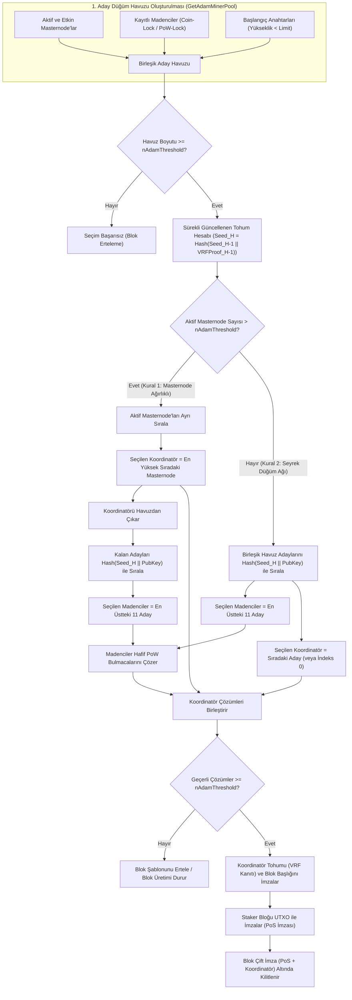

# Ağ Hash Gücünü ve Ödül Dağıtımını Merkeziyetsizleştirmek İçin Blokzincirlerinin PoW Bulmacalarını Çözmeye Yönelik Merkeziyetsiz Bir Yaklaşım Modeli (ADAM)

**Bedri Özgür Güler**  
*bedriguler@gmail.com*  

---

> [!NOTE]  
> *Bu makale, ADAM (A Decentralized Approach Model - Merkeziyetsiz Bir Yaklaşım Modeli) mutabakat mekanizmasının kavramsal çerçevesini ve gerçek üretim uygulamasını sunmaktadır. Aslen Ravencoin'in algoritma tartışmaları için tasarlanan model, KristaTech blokzinciri için tamamen uygulanmış ve uyarlanmıştır.*

---

## Özet

Bu makalede, Özel Entegre Devrelerin (ASIC'ler) ve Alanda Programlanabilir Kapı Dizilerinin (FPGA'ler) blok üretimini domine ettiği Proof-of-Work (PoW) mutabakatlı blokzincirlerindeki hash gücü merkezileşmesinin kaynağını analiz ediyoruz. Geleneksel "hash gücü yarışı" yerine iş birlikçi, dağıtık bir problem çözme modeli koyan merkeziyetsiz bir yaklaşım modeli (ADAM) öneriyoruz. Her blok yuvası için rastgele bir madenci havuzu ve bir koordinatör seçerek, hafif paralelleştirilmiş PoW bulmacaları dağıtarak ve blok hash'ini oluşturmak için sıralı bir hashing zinciri kullanarak ADAM, ASIC üretmenin ekonomik olarak fizibil olmamasını sağlar. Ek olarak, güvenli ve çift imzalı hibrit bir mutabakat topolojisi oluşturmak için bu modeli Proof-of-Stake (PoS) ile entegre ediyoruz.

---

## 1. Giriş

Satoshi Nakamoto’nun orijinal Bitcoin protokolü [1], birden fazla tarafın çift-SHA256 PoW bulmacasını çözmek için yarıştığı rekabetçi bir mücadeleye dayanır. Geçerli bir çözümü ilk yayınlayan taraf blok ödülünü alır. Bu rekabetçi dinamik doğası gereği ölçeği ödüllendirir: Bir madenci ne kadar çok hash gücü kontrol ederse, blok ödülünü kazanma olasılığı o kadar yüksek olur. 

Bu yarış hızlı bir şekilde CPU'lardan GPU'lara, ardından FPGA'lere ve nihayetinde ASIC'lere geçti. Çeşitli projeler, bellek gereksinimlerini artırarak veya hashing sırasını dinamik olarak değiştirerek (örneğin X16R) [2] "ASIC-dirençli" algoritmalar tasarlamaya çalışmaktadır. Ancak, bir kripto para birimi yeterince yüksek bir piyasa değerine ulaştığında, özel ASIC'ler geliştirmek son derece karlı hale gelir ve bu da ağ hash gücünün kaçınılmaz olarak merkezileşmesine yol açar.

Hash gücü merkezileşmesi ciddi riskler barındırır:
1. **%51 Saldırıları**: Dominant havuzları kontrol eden tekil kuruluşlar veya karteller işlem geçmişini yeniden yazabilir.
2. **Ekonomik Dışlanma**: Standart donanımlar (CPU'lar/GPU'lar) kullanan bireysel madenciler sistem dışına itilir ve bu da ağ dağılımını azaltır.
3. **EKOLOJİK ATIK**: Yarışı kazanamadıkları için çözümleri çöpe atılan rakip madenciler tarafından muazzam miktarda enerji israf edilir.

ADAM (A Decentralized Approach Model), "rekabetçi yarış" yerine, rastgele seçilen düğümler arasında **hash gücünün ve ödüllerin iş birlikçi bir şekilde dağıtılmasını** koyarak bu sorunları çözer.

---

## 2. Merkeziyetsiz Bir Yaklaşım Modeli (ADAM)

### Motivasyon
ADAM'ın temel motivasyonu; karmaşık bir mutabakat bulmacasını daha basit, paralelleştirilmiş kısmi problemlere bölerek, bunları ağ mutabakatı tarafından seçilen bir grup düğüme dağıtarak ve kanıtlarını tek bir iş birlikçi blok doğrulaması halinde birleştirerek madenciliği demokratikleştirmektir.

ADAM üç kritik sorunu çözer:
1. **ASIC Dominasyonu**: Uygun madencilerin alt kümesi her blok için rastgele değiştiğinden ve gerekli hashing algoritmaları dinamik olarak atandığından, statik ASIC tasarımları baskın bir rekabet avantajı elde edemez.
2. **Enerji Verimliliği**: Tüm ağın yarışıp elektrik israf etmesi yerine, yalnızca seçilen madenciler belirli bir blok yuvası için iş yapar.
3. **Refah Dağıtımı**: Blok ödülleri, iş birlikçi tura katılan tüm katılımcılar (seçilen madenciler ve koordinatör) arasında paylaştırılarak "eşit işe eşit ücret" dağıtımı sağlanır.

---

## 3. Matematiksel Formülasyon

İş birlikçi problem çözmenin teorik kavramı ile gerçek blokzinciri kodu arasında köprü kurmak için hem soyut operatör formülasyonunu hem de somut üretim uygulamasını sunuyoruz.

### 3.1. Teorik Çerçeve (Kriptografik Fonksiyon Bileşimi)

Blok başlığı durumlarını ve iş birlikçi hashing işlemlerini temsil etmek için kriptografik fonksiyon bileşimlerini kullanan klasik bir matematiksel çerçeve tanımlıyoruz.

#### 1. Blok Başlığının Temsili
$B(q, s)$, bir blok başlığının serileştirilmiş durumunu temsil etsin; burada $q$ nonce değeri ve $s$ ise coinbase işlemindeki `extraNonce` değeridir (bu değer, bloğun Merkle kökü aracılığıyla kriptografik olarak taahhüt edilir). Basitlik adına, blok durumunu $B$ veya $k$. madenciye özel yapılandırılmış hali için $B_k$ olarak gösteriyoruz.

#### 2. Hashing İşlemleri
$H$ özetleme fonksiyonunu (örneğin SHA-256 veya X11) bir blok başlığı durumuna uygulamak şu şekilde tanımlanır:

$$
H(B(q, s)) = \text{hash}(B(q, s)) \in \lbrace 0, 1 \rbrace^{256}
$$

Burada $H$, tek bir hashing algoritmasını veya farklı algoritmaların zincirlenmiş bir dizisini temsil edebilir.

#### 3. Teorik İş Birlikçi Problem
İş birlikçi doğrulama modeli, hedef Proof-of-Work (PoW) bulmacasını, seçilen her bir $i \in \lbrace 1, \dots, N \rbrace$ madencisi tarafından paralel olarak çözülen $N$ adet alt probleme böler:

$$h_i = H_i(C_i(q_i))$$

burada:
* $N$, seçilen madenci havuzunun boyutudur.
* $H_i$, $i$. madenciye permütasyonla atanan özel hashing fonksiyonudur.
* $C_i(q_i)$, $i$. madenciye özel olarak yapılandırılmış; bloğun VRF tohumunu, madencinin açık anahtarını ve kişisel nonce değeri $q_i$'yi içeren bulmaca görevidir.
* $h_i$, $i$. madenci tarafından kendi hedef zorluk sınırının altında hesaplanan hafif bulmaca hash çözümüdür.

#### 4. Kriptografik Bağlama (Zincirleme Bileşimi)
Blok başlığını, seçilen tüm madencilerin işlerine kriptografik olarak bağlamak için, blok başlığı $B$ üzerinde sıralı ve doğrusal olmayan bir $\mathcal{F}$ bileşim fonksiyonu tanımlıyoruz:

$$H_{\text{block}} = \mathcal{F}(B) = \mathcal{H}_N \circ \mathcal{H}_{N-1} \circ \dots \circ \mathcal{H}_1(B)$$

Burada her bir $\mathcal{H}_i$ adımı, önceki durumdan türetilen algoritma permütasyonları ve aralarında asal çarpanlar $m_i$ ile parametrelendirilmiş bir bileşim fonksiyonudur:

$$\mathcal{H}_i(X) = \left( H_i^{(1)}\left( H_i^{(2)}\left( H_i^{(3)}(X) \times (i + 1) \right) \times (i + 1) \right) \times m_i \right) \pmod{2^{256}}$$

Bu sıralı zincirleme, blok hash'i $H_{\text{block}}$'un yalnızca seçilen her bir $i$ madencisinin kendi hafif PoW bulmacasını başarıyla tamamlaması durumunda geçerli olmasını garanti eder. Herhangi bir katkının değiştirilmesi veya eksik olması zinciri kırarak nihai blok hash'ini geçersiz kılar.

---

### 3.2. Uygulanan Üretim Matematiği (KristaTech Blokzinciri)

Canlı bir blokzinciri veritabanında, kayan noktalı (floating-point) gösterimleri ve çarpımların toplamı şeklindeki hash'leri dağıtık düğümler arasında deterministik olarak doğrulamak zordur. Bunu çözmek için KristaTech üretim kod tabanı, teorik lineer kombinasyonu iki somut yapı kullanarak uygular: **Hafif PoW Bulmacaları (Lightweight PoW Puzzles)** ve **Durumsuz Hashing Zinciri (Stateless Hashing Chain)**.

#### 1. Hafif Bulmaca Çözme (Lightweight Puzzle Solving)
Seçilen her $i \in \lbrace 0, \dots, N-1 \rbrace$ madencisi, hafif bir bulmacayı çözerek iş yaptıklarını kanıtlamalıdır:

$$\text{PuzzleHash}_i = \text{CalculateAdamPuzzleHash}\left(\text{algoIndex}_i, \text{Seed}_H \mathbin{\Vert} \text{MinerPubKey}_i \mathbin{\Vert} \text{Nonce}_i\right)$$

Aşağıdaki hedef zorluk sınırına tabi olarak:

$$\text{PuzzleHash}_i \le \text{scaledTarget}$$

burada:
* $\text{Seed}_H$, mevcut blok yüksekliği için sürekli güncellenen (rolling) VRF tohumudur (seed).
* $\text{MinerPubKey}_i$, seçilen madencinin açık anahtarıdır.
* Başlangıç zorluk hedef sınırı (`powLimit`), Mainnet ve Testnet üzerinde `~UINT256_ZERO >> 20` (veya `0x1e0ffff0` değerine eşdeğer) olarak ayarlanmıştır. Bu, genesis başlangıç aşaması (bootstrapping) sırasında mikrosaniyelik blokları ve mutabakat bölünmelerini önler.
* $\text{scaledTarget} = \min(\text{Target} \ll \text{activeShift}, \text{powLimit})$ (Mainnet ve Testnet üzerinde; Regtest `scaledTarget = ~UINT256_ZERO` kullanır). Bu bit kaydırma işlemi (bit-shift) zorluğu gevşeterek, bulmacanın hafif kalmasını ve hedef blok süresi (30 saniye) içinde çözülebilir olmasını sağlar:
  * Fallback Modunda (`nVersion == 11`, `!NetworkUpgradeActive(nHeight, Consensus::UPGRADE_MODELD)` veya `!NetworkUpgradeActive(nHeight, Consensus::UPGRADE_ADAM_V2)`) $\text{activeShift} = \text{nAdamDifficultyShiftV1}$ (`10`).
  * Standart Modda (`nVersion >= 12`) hem `Consensus::UPGRADE_MODELD` hem de `Consensus::UPGRADE_ADAM_V2` aktif olduğunda (Mainnet'te Blok `2.200`, Testnet'te Blok `500` itibarıyla) $\text{activeShift} = \text{nAdamDifficultyShiftV2}$ (`6`).

Hashing algoritması indeksi ($\text{algoIndex}_i$) dinamik olarak atanır:
* **Geri Çekilme Modu (Fallback Mode - Sürüm 11)**: $\text{algoIndex}_i = \text{Hash}(\text{Seed}_H \mathbin{\Vert} \text{MinerPubKey}_i) \pmod{18}$, enerji tasarruflu 18 hash fonksiyonundan birini kullanır.
* **Standart Mod (Sürüm 12)**: Önceki bloğun hash'ine ve madencinin açık anahtarına dayanarak, mevcut 18 algoritma arasından deterministik olarak 3 farklı hashing algoritmasını ($\text{algo1}$, $\text{algo2}$ ve $\text{algo3}$) seçen 3-permütasyonlu bir seçici şema $\text{GetAdam3PermutationAlgos}(\text{hashPrevBlock}, \text{MinerPubKey}_i)$ kullanır. Çözücü bu üç algoritmayı birleştirir:

  $$\text{PuzzleHash}_i = \text{algo1}\left( (\text{minerIdx} + 1) \times \text{algo2}\left( (\text{minerIdx} + 1) \times \text{algo3}(\text{Challenge}) \right) \right) \pmod{2^{256}}$$

#### 2. Durumsuz Hashing Zinciri (Blok Hashing)
Blok başlığını, seçilen tüm madencilerin işlerine kriptografik olarak bağlamak için, blok hash'i ($H_{\text{block}}$), seçilen tüm madencilerin hashing işlemlerini sıralı olarak zincirleyerek hesaplanır. 

Serileştirilmiş bir blok başlığı $S$ için:
1. Her $i \in \lbrace 0, \dots, M-1 \rbrace$ turu için (Sürüm 11 Fallback Modunda $M = \text{vAdamMiners.size()} - 1$, Sürüm 12 Standart Modda ise $M = \text{vAdamMiners.size()}$), hash entropisini korumak için tek bir aralarında asal çarpan $m_i$ hesaplarız:

   $$\text{roundHash}_i = \text{Hash}\left(\text{hashPrevBlock} \mathbin{\Vert} i\right)$$

   $$m_i = \max\left(\text{roundHash}_i[0] \mid 1, 3\right)$$

2. Sürüm 11 Fallback Modunda her $i$ turu $\text{algo}_i = \text{Hash}(\text{hashPrevBlock} \mathbin{\Vert} \text{vAdamMiners}[i]) \pmod{18}$ ile tekli $\text{CalculateAdamPuzzleHash}(\text{algo}_i, \cdot) \times m_i \pmod{2^{256}}$ özeti uygular. Sürüm 12 Standart Modda ise 3-permütasyonlu turlar (`GetAdam3PermutationAlgos(hashPrevBlock, vAdamMiners[i])`) sıralı olarak zincirlenir:
   - **Tur 0**:
     * Madenci 0 için $\text{algo1}$, $\text{algo2}$ ve $\text{algo3}$ türetilir.
     * Hesaplama:

       $$H_0^{(3)} = \text{CalculateAdamPuzzleHash}(\text{algo3}, S)$$

       $$H_0^{(2)} = \text{CalculateAdamPuzzleHash}\left(\text{algo2}, \left( H_0^{(3)} \times 1 \right) \pmod{2^{256}}\right)$$

       $$H_0 = \text{CalculateAdamPuzzleHash}\left(\text{algo1}, \left( H_0^{(2)} \times 1 \right) \pmod{2^{256}}\right)$$

     * Çarpanı uygula:

       $$H_{\text{prev}} = (H_0 \times m_0) \pmod{2^{256}}$$

   - **Tur $i > 0$**:
     * Madenci $i$ için $\text{algo1}$, $\text{algo2}$ ve $\text{algo3}$ türetilir.
     * Hesaplama:

       $$H_i^{(3)} = \text{CalculateAdamPuzzleHash}(\text{algo3}, H_{\text{prev}})$$

       $$H_i^{(2)} = \text{CalculateAdamPuzzleHash}\left(\text{algo2}, \left( H_i^{(3)} \times (i + 1) \right) \pmod{2^{256}}\right)$$

       $$H_i = \text{CalculateAdamPuzzleHash}\left(\text{algo1}, \left( H_i^{(2)} \times (i + 1) \right) \pmod{2^{256}}\right)$$

     * Çarpanı uygula:

       $$H_{\text{prev}} = (H_i \times m_i) \pmod{2^{256}}$$

3. Nihai çıktı blok hash'idir:

   $$H_{\text{block}} = H_{\text{prev}}$$

Bu sıralı, lineer olmayan hashing zinciri, bir bloğun yalnızca katılan tüm iş birlikçi madencilik turlarının doğru matematiksel imzasını içermesi durumunda geçerli olmasını zorunlu kılar.

---

## 4. Uygulanan Üretim İşlem Yolu (Pipeline)

Mutabakat akışı, aşağıdaki işlem yoluna sahip bir **İş Birlikçi Hibrit Tur (Cooperative Hybrid Round)** olarak yapılandırılmıştır:

### 1. Aktif Düğüm Havuzu (Active Node Pool)
Aktif düğümlerin havuzu (`GetAdamMinerPool()`), ağdaki aktif Masternode'lardan (harcanmamış 4.200 KRISTA teminata ve son 2.880 blok içinde zincir üstü heartbeat ping'e sahip olanlar) ve aktif kayıtlı madencilerden zincir üstü deterministik olarak türetilir:
* **İki Yöntemle Madenci Kaydı**: Düğümler, madenci olarak iki yöntemden birini kullanarak kayıt olabilirler:
  * **Coin-Lock (Bakiye Kilitleme) Kaydı**: En az 250 KRISTA (`MINER_REGISTRATION_LOCK_AMOUNT = 250 * COIN`) tutarının, en az `nRegPeriod` blok boyunca kilitli kalacak bir CLTV kayıt çıktısına gönderilmesini gerektirir (manuel `registerminer "<adres>" "coin"` RPC komutu ve konsensüs doğrulaması tüm yüksekliklerde geçerlidir; arka plan `AutoRegisterMiner` otomasyonu ise Blok 2.200'den itibaren Coin-Lock'u otomatik seçer).
  * **PoW-Lock (PoW Kilitleme) Kaydı**: Yakın tarihteki bir blok hash'ine bağlı, çevrim dışı (out-of-band) çözülen bir Proof-of-Work bulmacasının, en az `nRegPeriod` blok boyunca geçerli bir CLTV kayıt çıktısında **10 KRISTA** (`POW_LOCK_REGISTRATION_AMOUNT = 10 * COIN`, en az 100 onaylı girdilerle fonlanan) veya **0 KRISTA** (aktif havuzda $< 13$ anahtar bulunduğunda `Zero-Coin PoW`) kilitlenerek sunulmasını gerektirir.
* **Kayıt Geçerlilik Süresi (`nRegPeriod`)**: Madenci kaydının geçerlilik süresi Mainnet üzerinde `2880` blok, Testnet/Regtest üzerinde ise başlangıçta `2880` bloktur (Model D ağ güncellemesi aktif olduğunda bu süre `100` bloğa düşürülür).
* **Genesis Başlangıç Aşaması (Bootstrap Madenci Havuzu)**: Çok az masternode veya kayıtlı madencinin aktif olduğu erken aşamalarda zincirin durmasını önlemek için:
  * **Mainnet**: Blok yüksekliği `nAdamBootstrapLimit` (44.850 blok) değerinin altında olduğu sürece, havuz 1 ila 199. bloklar arasındaki blok üreticilerinin açık anahtarlarını otomatik olarak kaydeder. ADAM konsensüsünün kendisinin blok 200'de başladığını, bunu blok 2.000'de POMBL ve blok 2.200'de Model D yükseltmelerinin izlediğini unutmayınız.
  * **Testnet**: Blok yüksekliği `nAdamBootstrapLimit` (100.000 blok) değerinin altında olduğu sürece, havuz 1 ila 199. bloklar arasındaki blok üreticilerinin açık anahtarlarını otomatik olarak kaydeder (Testnet üzerinde ADAM blok 200'de, POMBL blok 400'de, Model D blok 500'de başlar).
* **Regtest**: Havuz, otomatik testleri kolaylaştırmak amacıyla otomatik olarak 15 deterministik başlangıç açık anahtarını içerir.

### 2. Deterministik Lider Seçimi (SSLE) ve Çift Kulvarlı (Dual-Track) Kotalar
ADAM ağ yükseltmesinin (`Consensus::UPGRADE_ADAM`) aktif olduğu her $H$ blok yüksekliği için ağ, deterministik bir tekli gizli lider seçimi (SSLE) algoritması (`SelectAdamNodes`) kullanır.
* Seçim işlemi sürekli güncellenen bir tohum (rolling seed) kullanır:

  $$\text{Seed}_H = \text{Hash}\left(\text{Seed}_{H-1} \mathbin{\Vert} \text{VRFProof}_{H-1}\right)$$

* Havuzdaki her düğüm sıralanır:

  $$\text{Rank}_i = \text{Hash}\left(\text{Seed}_H \mathbin{\Vert} \text{PubKey}_i\right)$$

* $T_{\text{active}}$ ağdaki aktif masternode sayısı ve $T_{\text{threshold}}$ ise aktif çoğunluk eşiği (`GetAdamThreshold(nHeight)`, `nAdamThresholdBootstrapLimit` [Mainnet'te 50.000, Testnet'te 100.000, Regtest'te 1.000] altında `5`, sonrasında ise `nAdamThreshold` [Mainnet/Regtest üzerinde `7`, Testnet üzerinde `3`]) olsun:
  - **Kural 1 (Masternode Ağırlıklı Havuz: $T_{\text{active}} > T_{\text{threshold}}$)**: 
    * Aktif masternodlar ayrı olarak sıralanır: $\text{Rank}_{\text{mn}, i} = \text{Hash}(\text{Seed}_H \mathbin{\Vert} \text{PubKey}_{\text{mn}, i})$.
    * En yüksek sıralamadaki masternode **Koordinatör** (Coordinator) olarak seçilir.
    * Koordinatör doğrulayıcı aday havuzundan çıkarılır.
    * `nHeight >= consensus.nAdamDualTrackHeight` (`UPGRADE_ADAM` = Mainnet/Testnet'te blok 200, Regtest'te blok 1) olduğunda, $M = \text{nAdamMinersCount} = 11$ **Madenci** `ElectDualTrackValidators` ile seçilir: **1. Kulvar (8 koltuk)** içinde **7 koltuk** Aktif Masternode'lara (`4.200 KRISTA`) ve **1 koltuk** Coin-Lock madencilerine (`250 KRISTA`) ayrılır (Kulvar-1 içi anında taşma/spillover desteklidir); **2. Kulvar (3 koltuk)** ise Açık PoW madencilerine (`10 KRISTA` PoW-Lock / `0 KRISTA` Zero-Coin PoW / Bootstrap) ayrılır ve kulvarlar arası çift yönlü taşma uygulanır.
  - **Kural 2 (Seyrek Düğüm Ağı: $T_{\text{active}} \le T_{\text{threshold}}$)**:
    * `nHeight >= consensus.nAdamDualTrackHeight` olduğunda, en üstteki $M = 11$ **Madenci** `ElectDualTrackValidators` (`7 Aktif MN + 1 Coin-Lock + 3 Açık PoW`, taşma destekli) ile seçilir ve kalan en yüksek sıralamadaki aday **Koordinatör** olarak atanır.

* **Etkinleştirme Modları**:
  - **Geri Çekilme Modu (Fallback Mode - Blok Sürümü 11)**: `Consensus::UPGRADE_ADAM` ağ yükseltmesi aktif olduğunda (Mainnet/Testnet/Regtest üzerinde 200 yüksekliğinde) ve `Consensus::UPGRADE_POMBL` yükseltmesi aktif olmadığında etkinleşir. Son madenci Koordinatör olacak şekilde esnek bir madenci listesi (`nAdamThreshold + 1` ile `14` düğüm arası) bekler.
  - **Standart Mod (Blok Sürümü 12)**: `Consensus::UPGRADE_POMBL` ağ yükseltmesi aktif olduğunda (Mainnet'te 2000, Testnet'te 400, Regtest'te 300 yüksekliğinde) deterministik olarak etkinleşir. Tam olarak `nAdamMinersCount = 11` madenci ve 1 bağımsız Koordinatör olmasını zorunlu kılar.

### 3. Çözüm Aşaması (Hafif PoW)
Seçilen madenciler hafif PoW bulmacasını çözer ve kısmi çözümlerini P2P ağı üzerinden yayınlar. Çözüm şunları içerir:
* `nNonce`: Bulmacayı çözen 32-bitlik nonce değeri.
* `vchSig`: Madencinin çözülen `puzzleHash` üzerindeki kriptografik imzası; bu imza `VerifyBLSWithECDSAFallback` şeması kullanılarak doğrulanır.

### 4. Yetim Çözüm Önbelleği (Orphan Solution Cache)
Ağ yayılım gecikmesinin neden olduğu blok birleştirme durmalarını önlemek için düğümler, sırasız alınan çözümleri önbelleğe alır (`mapOrphanAdamSolutions`). Bir düğüm, önceli henüz işlenmemiş bir blok yüksekliği için bir bulmaca çözümü aldığında, bunu yetim önbelleğinde tutar ve öncel blok blok dizinine eklendiğinde işler.

### 5. Birleştirme, Doğrulama Çoğunluğu (Quorum), Yedek Koltuk Devri ve Zamana Bağlı Eşik Gevşetme
Koordinatör çözümleri birleştirir. Sabotajı veya çevrimdışı düğüm sorunlarını önlemek için ağ, seçilen madencilerden bir çoğunluk eşiği ($T = \text{GetAdamThreshold}(nHeight)$) zorunlu kılar:
* **Bootstrap Aşaması (`nHeight < nAdamThresholdBootstrapLimit`, yani Mainnet'te 50.000, Testnet'te 100.000, Regtest'te 1.000)**: Seçilen 11 madenciden en az `5` geçerli çözüm (Testnet'te bootstrap sonrasında `3`) gerektirir.
* **Bootstrap Sonrası (`nHeight >= nAdamThresholdBootstrapLimit`)**: Mainnet/Regtest üzerinde en az `nAdamThreshold = 7` geçerli çözüm (Testnet'te `3`) gerektirir.
* **Yedek Doğrulayıcı Koltuk Devri ($t \ge 60\text{ sn}$)**: Birincil komite koltukları `nTimeElapsed >= 60 sn` (`ADAM_COMMITTEE_FALLBACK_TIMEOUT_SECS = 60`, her `ADAM_COMMITTEE_FALLBACK_SLOT_SECS = 30` saniyelik slotta ilerleyerek) boyunca sessiz kalırsa, `ResolveAdamCommitteeForTime` / `ValidateAdamCommitteeForTime` aktif Koordinatörün çözülmemiş birincil koltukları yalnızca aynı kulvardaki yedek adaylarla (`MN -> MN`, `Coin-Lock -> Coin-Lock`, `Open PoW -> Open PoW`) sıralı olarak değiştirmesine izin verir (bloğun kendi `CCoinsViewCache* pView` görünümüne göre doğrulanır).
* **Zamana Bağlı Eşik Gevşetme ($t \ge 120\text{ sn}$)**: Komite buna rağmen temel $T$ eşiğine ulaşamazsa, `GetAdamEffectiveThreshold(nHeight, nTimeElapsed, nActiveMasternodes)` fonksiyonu $t = 120\text{ sn}$'den itibaren her `60 sn`'de bir eşiği `1` düşürerek `ADAM_MIN_RELAXED_THRESHOLD = 5` değerine (`> 4` MN-dışı koltuk; bootstrap sonrasında veya aktif MN $\ge 7$ iken en az 1 Aktif Masternode katılımını zorunlu kılar; seyrek bootstrap döneminde `nHeight < nAdamThresholdBootstrapLimit` ve aktif MN $< 7$ iken `ADAM_MIN_RELAXED_THRESHOLD_BOOTSTRAP = 3` tabanına) kadar gevşetir.
* **Eşit Emek, Eşit Kazanç ve %50 Otomatik Protokol Yakımı**: Model D kapsamında bulmacasını çözen her koltuk (`!vAdamSolutions[i].empty()`, birincil veya aynı kulvar yedek doğrulayıcısı) %40'lık Katılımcı Onaylayıcı Havuzundan (7 Masternode onaylayıcı koltuğu için toplam %20 [koltuk başı `~%2,857`] + 4 bağımsız madenci koltuğu için toplam %20 [1 Coin-Lock `%8,00` + 3 Açık PoW koltuk başı `%4,00`]; kulvarlar arası taşmada yerleşen doğrulayıcı kendi kulvar oranını alır) kendi kulvar payının %100'ünü alırken, çözülmeyen koltuklar `%0` alır ve Koordinatör yedek doğrulayıcılarla bloğu kurtardığında tam %15'lik ödülünü korur; sahipsiz kalan paylar (`nUnclaimedPartSplit`) **%50 Otomatik Protokol Yakımına (`nExpectedBurn = nUnclaimedPartSplit / 2`)** ve **%50 Geliştirici Hazinesine (`nExpectedTreasury = nTreasurySplit + (nUnclaimedPartSplit - nExpectedBurn)`)** bölüştürülür.

Çoğunluk sağlanırsa Koordinatör, sürekli güncellenen tohumu imzalayarak `vAdamVRFProof` üretir ve hibrit BLS12-381 + ECDSA geri çekilme imza mekanizmasını (`SignBLSWithECDSAFallback`) kullanarak nihai blok başlığını imzalar (`vAdamCoordinatorSig`).

### 6. İş Birlikçi Proof-of-Stake (PoS)
$\ge 200$ bloklarında mutabakat PoS ile entegre olur. Staker'ın cüzdanı, çekirdek (kernel) hash zorluğunu doğrular (kümülatif `CalculateMPAWeight()` kullanarak). Geçerli bir staking UTXO'su bulunduğunda, staker'ın cüzdanı `SelectAdamNodes` aracılığıyla mevcut blok yüksekliği için seçilen madencileri alır ve bu seçilen madenciler tarafından çözülen hafif PoW bulmacalarını P2P ağı bellek önbelleğinden (`mapAdamSolutionsCache`) toplar. Çözüm çoğunluk eşiği henüz karşılanmamışsa blok şablonu üretimi ertelenir. Eşik karşılandığında, aktif Koordinatör anahtarı yerel düğümdeyse `vAdamVRFProof` ve `vAdamCoordinatorSig` doğrudan imzalanır; aktif Koordinatör uzak bir Masternode veya doğrulayıcı düğümdeyse staker P2P ağı üzerinden ECDSA kimlik doğrulamalı bir `POSCOORDREQ` (`SignPoSCoordRequest`) yayınlar, uzak Koordinatör ise `VerifyPoSCoordRequestAuth` ve `TestBlockValidity` kontrollerini geçirip `AcquireCoordinatorProposalSlot` yuvasını ayırarak `POSCOORDSIG` (`vAdamVRFProof` + `vAdamCoordinatorSig`) yanıtını döndürür (Model D aktifse ardından LLMQ `RequestBlockQuorumSig` alınır). Son olarak staker, staking UTXO gizli anahtarını (`vchBlockSig`) kullanarak bloğu imzalar; böylece tamamen bağımsız düğümler arasında dahi hem PoS hem de PoW güvenliğini birleştiren çift imza (PoS Blok İmzası + ADAM Koordinatör İmzası) kilidi sağlanır.

---

## 5. Güvenlik Analizi ve Önlemler

ADAM'ın KristaTech blokzincirindeki üretim uygulaması, birkaç standart mutabakat güvenlik açığına karşı sağlamlaştırılmıştır:

### A. Sybil Saldırıları
* **Tehdit**: Kötü niyetli bir aktör, oy gücünün çoğunluğunu elde etmek ve lider seçimini kontrol etmek için binlerce ucuz sanal özel sunucu (Sybil) kurar.
* **Önlem**: KristaTech, Mainnet ve Testnet üzerinde seçim havuzunu zincir üstü doğrulanabilir Sybil-dirençli kulvarlarla sınırlandırır: aktif Masternode'lar (`4.200 KRISTA` teminat), Coin-Lock doğrulayıcıları (`250 KRISTA` CLTV kilidi) ve PoW-Lock / bootstrap doğrulayıcıları (`10 KRISTA` CLTV + 28-bit PoW; yalnızca `nAdamBootstrapLimit` öncesindeki ilk önyükleme evresinde `< 13` açık doğrulayıcı sınırı altında Sıfır-Coin 24-bit PoW ve Blok `1..199` coinbase geri dönüşü). 15 anahtarlı deterministik kriptografik anahtar havuzu (keypool) geri dönüşü ise **yalnızca Regtest** ortamındaki otomatik birim/fonksiyonel test altyapısı için tanımlıdır ve Mainnet veya Testnet üzerinde asla aktif değildir. Bu mimari, Sybil saldırılarını ekonomik ve hesaplamalı açıdan imkansız hale getirir.

### B. DDoS ve Lider Hedefleme
* **Tehdit**: Bir sonraki blok üreticisinin IP adresi önceden bilinirse, saldırganlar blokzincirini durdurmak için düğüme DDoS saldırısı düzenleyebilir.
* **Önlem**: Liderler, sürekli güncellenen VRF tohumu (rolling VRF seed) kullanılarak seçilir. Düğümler seçim sıralamalarını yerel olarak hesaplar. Tohum yinelemeli olarak güncellendiğinden ve imzalar deterministik olduğundan, bir sonraki liderin kimliği imzalı bir blok başlığı yayınlayana kadar gizli kalır ve bu da önleyici hedeflemeyi engeller.

### C. Sabotaj, Ağ Gecikmesi ve Kilitlenme Kurtarma
* **Tehdit**: Çevrimdışı madenciler, ağ gecikmesi veya 5+ birincil koltuğun aynı anda düşmesi, Koordinatörün yeterli çözümü toplamasını engelleyerek blok üretimini durdurur.
* **Önlem**: Ağ, seçilen `nAdamMinersCount = 11` madenci arasından `GetAdamThreshold(nHeight)` (Mainnet/Regtest üzerinde bootstrap süresince `5` ve sonrasında `7`; Testnet üzerinde bootstrap sonrasında `3`) ile tanımlanan bir çoğunluk eşiğini iki otomatik kurtarma mekanizmasıyla birlikte uygular: (1) **Aynı Kulvar Yedek Koltuk Devri ($t \ge 60\text{ sn}$)** ile sessiz kalan birincil koltukların aynı teminat kulvarındaki (`MN -> MN`, `Coin-Lock -> Coin-Lock`, `Open PoW -> Open PoW`) sıradaki yedek doğrulayıcılarla değiştirilmesi ve (2) **Zamana Bağlı Eşik Gevşetme ($t \ge 120\text{ sn}$)** ile eşiğin her `60 sn`'de bir `1` düşürülerek `ADAM_MIN_RELAXED_THRESHOLD = 5` değerine kadar gevşetilmesi. **Yetim Çözüm Önbelleği (Orphan Solution Cache)** sırasız çözümleri tutar, düğüm genelindeki **`ActiveProposalGuard`** ise aynı ebeveyn blok üzerinde çift PoW+PoS blok önerisini engeller.

### D. Çift İmza Güvenliği
* **Tehdit**: %51 PoW veya %51 PoS gücüne sahip bir saldırgan blokzincirini yeniden düzenlemeye (reorganize) çalışır.
* **Önlem**: Blokzincirini yeniden düzenlemek, *hem* staking ağırlığının %51'ini hem de seçilen ADAM koordinatörü ve madencilerinin gizli anahtarlarını kontrol etmeyi gerektirir. Bu çift imzalı kilitleme, geçmişin yeniden düzenlenmesini neredeyse imkansız hale getirir.

---

## 6. İstatistiksel Analiz

ASIC'lere karşı ekonomik korumayı göstermek için madencilik donanımı dağılımını analiz ediyoruz.

Şu tanımları yapalım:
* $N$, toplam madencilik istemcisi sayısı olsun.
* $K$, standart bir GPU istemcisinin hash hızı (hash rate) olsun.
* FPGA'ler, GPU'lardan $7 \times$ daha verimli olsun ($7K$).
* ASIC'ler, GPU'lardan $50 \times$ daha verimli olsun ($50K$).

### Durum 1: Rekabetçi Yarış (Geleneksel PoW)
Ağın %10'u ASIC'lerden oluşuyorsa:
* Toplam ASIC gücü: $0.1N \times 50K = 5N K$
* Toplam GPU gücü: $0.9N \times K = 0.9N K$
* Çıkarılan ASIC bloklarının oranı: $\frac{5}{5.9} \approx 84.7$%

ASIC madencileri blok ödüllerinin neredeyse %85'ini kazanarak ağı merkezileştirir ve GPU madencilerini ayrılmaya zorlar.

### Durum 2: İş Birlikçi Tur (ADAM)
ADAM'da yalnızca seçilen düğümler katılır. Bir ASIC düğümünün seçilme olasılığı $P_e$, hash gücüne değil, aktif Masternode teminatındaki payına orantılıdır. 

Seçildikten sonra hafif bulmaca, hem GPU'lar hem de ASIC'ler tarafından anında çözülür (çünkü hedef $2^{\text{activeShift}}$ kadar gevşetilmiştir). 
* Katılımcı doğrulayıcı havuzu (Model D kapsamında net blok ödülünün %40'ı), tüm $M = 11$ komite koltuğu arasında kulvar kotalarına göre deterministik olarak dağıtılır (1 Coin-Lock koltuğu için `%8,00` + 3 Açık PoW koltuğu için koltuk başına `%4,00` ve 7 Masternode doğrulayıcı koltuğu için koltuk başına `~%2,857`).
* Seçilen tek bir koltuğun blok başına kazanabileceği maksimum ödül, tüketici sınıfı bir GPU veya endüstriyel bir ASIC kullanmasından bağımsız olarak sabit tekil koltuk payı ile sınırlıdır.
* Pahalı hashing ASIC'lerine yatırım yapmak koltuk başına ek bir blok ödülü getirmez, bu da ASIC geliştirmeyi ekonomik olarak elverişsiz kılar.

---

## Kaynaklar

* **[1]** Nakamoto, S. (2008). *Bitcoin: A Peer-to-Peer Electronic Cash System.*
* **[2]** Ravencoin Team. (2018). *X16R Whitepaper.*
