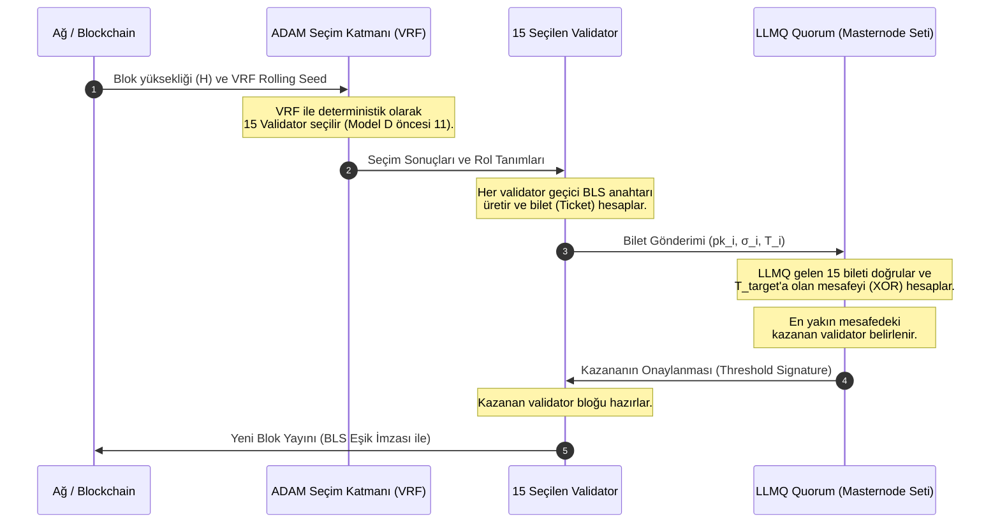

# Proof of BLS (PoBLS) Consensus: Konsensüs ve Teşvik Yapısı

Bu doküman, KristaTech (KRISTA) ağında uygulanan yenilikçi ve hafif bir konsensüs modeli olan **Proof of BLS (PoBLS)** mekanizmasının kavramsal tasarımını, entegrasyonunu ve Model D ödül yapısını içermektedir.

---

## 1. Giriş ve Arka Plan

Geleneksel Proof of Work (PoW) yüksek enerji tüketimine yol açarken; standart Proof of Stake (PoS) ise zenginlerin daha çok kazandığı ("rich get richer") ve ağ kontrolünü kolayca ele geçirebildiği bir yapıya evrilebilir. 

**Proof of BLS (PoBLS)**, her blokta düğümlerin (peers) geçici (ephemeral) kriptografik anahtarlar üreterek katıldığı, merkeziyetsiz bir **kriptografik çekiliş (cryptographic lottery)** modelidir. Bu model, madencilik için yüksek işlem gücü gereksinimini ortadan kaldırırken, ağdaki tüm aktif katılımcılara adil bir blok üretme şansı sunar.

---

## 2. Adım Adım Çalışma Mekanizması (Kavramsal Tasarım)

> [!NOTE]
> **Kavramsal ve Üretim Yürütmesi Ayrımı:** Bölüm 2–4, bağımsız PoBLS tasarımının kavramsal modelini ve tehdit analizini sunar. Bölüm 5.4 ise doğrudan üretim C++ uygulamasını (`src/adam.cpp`, `src/llmq.cpp`, `src/crypto/bls.cpp`) belgeler: KTDIP3 Masternode'lar (`UPGRADE_DIP3 = 1` Mainnet ve Testnet) doğrudan zincir üstü kayıtlı `blsPubKeyOperator` anahtarıyla (`SignBLSOperatorOnly` / `VerifyAdamOrDip3Signature`, boş `ecdsaSig`) imzalar; DIP3 öncesi/MN dışı doğrulayıcılarda deterministik `DeriveBLSFromCKey` anahtarları `secp256k1` (`VerifyStrictDER` + `blockHash` ve aktif-zincir yüklemi izleyen çatal-farkındalıklı `PinBLSPubKey`, artı `UPGRADE_HARDENING_V4` altında zorunlu `<blsPubKey(48B)> <blsPoP(96B)> OP_2DROP` madenci kayıt sabitlemesi) ile yetkilendirilir; `ComputePoBLSTicket` komite `ADAMSOL` çözümleri içinden özel anahtarı hash'lemeden `SHA256D(blsPubKey || blsSig || nBlockHeight)` biletini türetir ve önbellekten bağımsız (`H-3`) ağırlıksız XOR mesafesi (`ComputePoBLSXORDistance`), `UPGRADE_HARDENING_V4` ile `ADAM_VRF_KEY_MATURITY = 100` blok önceliğini koruyarak $t \ge 45\text{ sn}$ anında yedek koordinatörleri sıralar.

Ağdaki her blok döngüsünde (örneğin her 30 saniyede bir) kavramsal modelde şu adımlar izlenir:

### 2.1. Bilet Üretimi (Ticket Generation)
1. Her aktif cüzdan/düğüm $i$, o blok yüksekliği ($H$) için özel yeni bir geçici **BLS anahtar çifti** üretir:
   
   $$\text{BLS Keypair}_i = (sk_i, pk_i)$$
   
2. Düğüm, gizli anahtar (private key) ve açık anahtarın (public key) kombinasyonunu blok yüksekliği ile birleştirerek bir hash (bilet) oluşturur:
   
   $$T_i = \text{Hash}(sk_i \parallel pk_i \parallel H)$$
   
3. Düğüm, gizli anahtarını ağa ifşa etmeden sahipliğini kanıtlamak için, bir önceki bloğun hash değerini ($Hash$) bu yeni geçici anahtarla imzalar:
   
   $$\sigma_i = \text{Sign}_{sk_i}(Hash_{prev})$$
   
4. Düğüm, ağa açık anahtarını ($pk$), imzasını ($\sigma$) ve bilet hash'ini ($T$) içeren bir **PoBLS Katılım Mesajı** yayınlar.

### 2.2. Bilet Toplama ve Zaman Penceresi (Submission Window)
* Blok süresinin çok küçük bir diliminde (örneğin ilk 5-10 saniye içinde) tüm düğümler katılım mesajlarını ağa veya aktif **LLMQ Quorum** (Long-Living Masternode Quorum) düğümlerine gönderir.
* LLMQ üyeleri gelen tüm biletleri doğrular ($\sigma$ imzasının $pk$ ile uyuşup uyuşmadığını kontrol eder) ve listeler.

### 2.3. Kazananın Belirlenmesi (Winner Selection)
1. O blok için ağ tarafından belirlenen bir **Hedef Hash** ($T_{target}$) hesaplanır (Örn: Bir önceki bloğun hash değeri veya aktif VRF tohumu).
2. Toplanan geçerli biletlerin hedef hash'e olan mesafesi (XOR metriği veya mutlak fark) hesaplanır:
   
   $$D_i = |T_i \oplus T_{target}|$$
   
3. Hedef hash'e **en yakın** (en küçük $D$ mesafesine sahip) bileti üreten düğüm, o blok için **blok üretme hakkını (block production right)** kazanır.
4. LLMQ Quorum'u, en yakın mesafedeki kazananı doğrular ve ortak bir eşik imzası (threshold signature) ile onaylayarak ağa duyurur.

### 2.4. Blok Üretimi ve Doğrulama
* Kazanan düğüm, bloğu hazırlar. Coinbase işleminde kendi bilet detaylarını ($pk_i, \sigma_i$) sunar.
* Diğer düğümler bloğu aldıklarında, kazananın biletinin gerçekten de LLMQ tarafından toplanan ve hedefe en yakın bilet olduğunu doğrular ve bloğu zincire ekler.

---

## 3. Güvenlik ve Tehdit Analizi

### 3.1. Sybil Saldırıları (Sybil Attacks) ve Önleme Yolları
> [!WARNING]
> Bilet üretmek tamamen ücretsiz olursa, bir saldırgan AWS/GCP üzerinde 100.000 ucuz sanal sunucu açarak 100.000 bilet üretebilir ve her bloğu kazanma şansını %99'a çıkarabilir.

**Çözüm Önerileri:**
* **Masternode Tabanlı PoBLS:** Bilet gönderme hakkı sadece teminatı (4.200 KRISTA) olan aktif masternode'lara verilir. Bu durumda Sybil saldırısı yapmak, devasa miktarda KRISTA satın alıp kilitlemeyi gerektireceğinden ekonomik olarak imkansızlaşır.
* **Stake Ağırlıklı Mesafe (Stake-Weighted Distance):** Herhangi bir cüzdan bilet gönderebilir, ancak hesaplanan mesafe ($D_i$) cüzdandaki coin miktarı ile bölünür:
  
  $$D_{weighted} = \frac{D_i}{\text{Balance}}$$
  
  Bu sayede daha çok bakiyesi olan cüzdanların biletleri hedefe daha yakın hale gelir (hibrid PoS/PoBLS yapısı).

### 3.2. Nothing-at-Stake ve Ön-Hesaplama (Pre-computation) Saldırısı
> [!CAUTION]
> Bir düğüm, gizli anahtarı kendisi ürettiği için yerel olarak saniyede milyonlarca BLS anahtar çifti üretip, hedef hash'e en yakın olanı seçip sadece onu gönderebilir. Bu durum PoBLS'i bir anda işlemci gücüne dayalı klasik bir PoW yarışına dönüştürür.

**Çözüm Önerisi:**
* Bilet üretiminde kullanılan BLS anahtar çiftinin deterministik olarak düğümün sabit kimliğine (node ID/Masternode UTXO) ve bir önceki bloğun verilerine bağlı olması gerekir. Örneğin:
  
  $$pk_i = \text{DeriveKey}(sk_{node}, Hash_{prev})$$
  
  Düğümler rastgele anahtar üretemez; her düğümün o blok için üretebileceği sadece tek bir geçerli bilet olabilir. Bu, pre-computation yarışını tamamen engeller.

---

## 4. Performans ve Ağ Yükü

* Her blokta binlerce düğümün tüm ağa bilet yayınlaması ciddi bir ağ trafiğine (network congestion) neden olur.
* **LLMQ Çözümü:** Ağ, coğrafi veya topolojik olarak LLMQ Quorum'larına bölünür. Her düğüm biletini kendi bölgesindeki en yakın LLMQ masternode'una gönderir. LLMQ kendi içinde sadece en yakın ilk 5 bileti üst quoruma veya ana ağa iletir. Bu sayede ağ trafiği minimumda tutulur.

---

## 5. ADAM Konsensüsü ile Entegrasyon (ADAM + PoBLS Hibrit Yapısı)

PoBLS bilet sisteminin tek başına kullanılması yerine, KristaTech'in çekirdek teknolojisi olan **ADAM (A Decentralized Approach Model)** kooperatif konsensüsü ile entegre edilmesi, güvenlik ve verimliliği en üst seviyeye taşır. Entegrasyon şu şekilde kurgulanabilir:

### 5.1. Seçim Katmanı Olarak ADAM (Sybil Direnci)
* ADAM konsensüsü, VRF (Verifiable Random Function) protokolü aracılığıyla her blok döngüsü için aktif doğrulayıcı havuzundan deterministik olarak Dengeli Model D altında **15 adet madenci düğümü (Validator Set)** (Model D öncesi **11**) seçer.
* **PoBLS Entegrasyonu:** Tüm ağın veya binlerce düğümün bilet göndermesi yerine, **sadece o blok için ADAM tarafından seçilen 15 validator** (Model D öncesi `11`) PoBLS bilet çekilişine katılabilir.
* Bu entegrasyon, Sybil saldırısı (sahte sunucular açarak bilet doldurma) riskini tamamen sıfırlar; çünkü bilet gönderebilecek düğüm kümesi önceden ADAM konsensüsü ile sınırlandırılmış ve doğrulanmıştır.

### 5.2. Blok Üretici Belirleme Katmanı Olarak PoBLS (DDoS ve Sansür Koruması)
* Klasik ADAM konsensüsünde, seçilen madencilerin sırası belirli olduğundan, kötü niyetli bir aktör sıradaki blok üreticisini önceden tahmin edip ona DDoS saldırısı düzenleyerek ağı yavaşlatabilir veya işlemleri sansürleyebilir.
* **PoBLS Entegrasyonu:** Seçilen 15 ADAM madencisi (Model D öncesi `11`) kendi aralarında geçici BLS anahtarları ile bilet oluşturur ve Quorum'a (LLMQ) gönderir. Quorum içinde yapılan en yakın mesafe çekilişi ile blok üreticisi anlık olarak belirlenir.
* Blok üreticisi bilet hash'i hedefe en yakın olana kadar dışarıdan tahmin edilemez. Bu durum, ağdaki **tek hata noktalarını (single point of failure)** ortadan kaldırır ve sansür direncini maksimize eder.

### 5.3. Entegrasyon İş Akışı (Workflow)

### 5.4. Üretim (Production) Konsensüs Uygulaması (`src/adam.cpp`, `src/llmq.cpp`, `src/crypto/bls.cpp`)
Üretim C++ kod tabanında PoBLS + ADAM iş akışı tam kriptografik sadakatle yürütülür:
1. **ADAM Çift Kulvarlı (Dual-Track) + Zincir Üstü Masternode Seçimi (`SelectAdamNodes` & `ElectDualTrackValidators`)**: Döngüsel VRF tohumu $\text{Seed}_H = \text{SHA256D}(\text{Seed}_{H-1} \parallel \text{blsPubKey}_{H-1} \parallel \text{blsSig}_{H-1})$ (`ComputeNextAdamSeed`) kullanılarak, tüm geçerli adaylar $\text{SHA256D}(\text{Seed}_H \parallel \text{PubKey}_i)$ ile deterministik olarak sıralanır ve 1 Koordinatör ile aktif komite (`GetAdamMinersCount(h)`: **Dengeli Model D altında `15` Validator** [`UPGRADE_MODELD`: Mainnet `5.000` / Testnet `500` / Regtest `200`; `GetAdamMinerPool` içinde Regtest deterministik havuzu **20 anahtara** çıkarılmıştır], **Model D öncesinde `11` Validator**) seçilir. `UPGRADE_FAIRNESS` ve `UPGRADE_HARDENING_V4` (`Yükseklik 1`) altında Koordinatör seçiminde orantılı kilitli sermaye ağırlıklı VRF (Aktif MN'ler `4.200`, `Coin-Lock` `250`, `Fonlu PoW-Lock` `10`, fonlu doğrulayıcı varken Zero-Coin `0`), **`ADAM_VRF_KEY_MATURITY = 100` blok** olgunluk kuralını (birincil Koordinatörü `maturedCandidates` içinden çeker, yalnızca olgunlaşmış aday yoksa `weightedCandidates` havuzuna düşer), `ProUpRegTx` operatör BLS anahtar rotasyonları arasında **`consensus.nProUpRegCooldownBlocks = 100` blok** bekleme süresini (`nOperatorKeyHeight`, `bad-proupreg-cooldown`) ve **Model D altında `11 * sumNonMN > 9 * sumMN` durumunda kesin `>= %55` Aktif MN güvenlik tabanlı `ADAM_FAIR_COORD_V5`** (`3 * sumNonMN > sumMN` ile Model D öncesi `>= %75` tabanlı `ADAM_FAIR_COORD_V4`) uygular; `SelectAdamNodes` önbellek anahtarını `fOpenEntry`, `fHardeningV3`, `fHardeningV4`, `fModelD` ve `vrfMaturedKeys` sınırlarında izole eder. `nHeight >= consensus.nAdamDualTrackHeight` (`UPGRADE_ADAM` = Mainnet/Testnet'te blok `200`, Regtest'te blok `1`) olduğunda koltuklar Çift Kulvarlı Kotalar (`GetAdamTrackQuotas`) ile tahsis edilir: **Dengeli Model D (`15` koltuk: `8 + 2 + 5`)** altında **1. Kulvar (Teminatlı Havuz — `10` Koltuk)** kendi içinde Alt-Kulvar 1A (`CDeterministicMNManager` / `ProRegTx` v2 / `ProUpServTx` ile deterministik durumda olan ve PoSe cezası bulunmayan harcanmamış `4.200 KRISTA` teminatlı Aktif KTDIP3 Masternode'lar için **`8` koltuk**) ve Alt-Kulvar 1B (`250 KRISTA` Coin-Lock madencileri için kesin izole **`2` koltuk**, Fonlu PoW-Lock havuzu dolduğunda `AutoRegisterMiner` ile doldurulur/yenilenir) olarak ayrılır; **2. Kulvar (Açık PoW Havuzu — `5` Koltuk)** ise **`3` Fonlu PoW-Lock (`10 KRISTA`) / Bootstrap koltuğu + `2` Kalıcı Ücretsiz Katılım (`0 KRISTA` Zero-Coin / Open-Entry) koltuğuna** ayrılır (boşsa Fonlu PoW-Lock/Bootstrap adaylarına düşer; seçilemeyen `Coin-Lock` `Kademe 2A` dışına çıkarılmıştır). **Model D öncesi (`11` koltuk: `7 + 1 + 3`)** ise **`7` Aktif MN + `1` Coin-Lock + `3` Açık PoW (`2` Fonlu + `1` Ücretsiz Katılım)** tahsis eder. Sıralı boş koltuk taşması (**Aktif Masternode $\to$ Açık PoW [Fonlu/Bootstrap, ardından `fOpenEntry` altında Zero-Coin] $\to$ Coin-Lock son çare**) izlenir; yedek sıralaması Model D'de $M=15$ (`m >= 15`) sonrası başlar (Model D öncesi `m = 11..16`).
2. **10-Alan Ayrıştırılmış BLS12-381 Anahtarları, Strict DER, Çatal-Farkındalıklı `PinBLSPubKey` ve Zorunlu V4 Kayıt Sabitlemesi (`SignBLSOperatorOnly`, `GetBLSDomainTag`, `VerifyStrictDER` & `ComputePoBLSTicket`)**: Birleşik **KTDIP3 (`UPGRADE_DIP3 = 1`)**, **`UPGRADE_HARDENING_V3` (`Yükseklik 1`)** ve **`UPGRADE_HARDENING_V4` (`Yükseklik 1`)** kapsamında BLS12-381 imzaları protokoller arası imza tekrarını önlemek için 10 ayrı DST (`ADAM_VRF`, `ADAM_COORD`, `ADAM_SOL`, `LLMQ_BLOCK`, `LLMQ_TREASURY`, `POS_BLOCK`, `POS_COORD_REQ`, `PROTX_UPSERV`, `PROTX_UPREV`, `PROTX_POP` / `blsPoP`) zorunlu kılar. Kayıtlı Masternode'lar doğrudan zincir üstü kayıtlı operatör anahtarı `blsPubKeyOperator` ile (`SignBLSOperatorOnly` / `VerifyAdamOrDip3Signature`, kesin boş `ecdsaSig` zorunluluğu ve yasaklı/iptal edilmiş MN durumunda hata kapalı [fail-closed] ret) imzalar; V4 altında tüm Coin-Lock, Fonlu PoW-Lock ve Zero-Coin madenci kayıtları `<blsPubKey(48B)> <blsPoP(96B)> OP_2DROP` ön ekini taşımak ZORUNDADIR (`CheckRegistrationBlsBinding`: `bad-txns-minerreg-missing-bls`, `bad-txns-minerreg-bls-pop`, `bad-txns-minerreg-dup-bls`; PoW ön-görüntüleri `"POWLKv4"` / `"SYBILV4"` son ekleriyle `Hash(challenge || blsPubKey)` bağlar ve LevelDB `"adamregcache_v3"` içinde kalıcı tutulur); MN dışı ve eski doğrulayıcılar ise kanonik strict-DER/low-S `secp256k1` (`VerifyStrictDER` / `SignBLSWithECDSAFallback`) ile yetkilendirilmiş deterministik $sk_i = \text{BLST}\underline{\hspace{0.4em}}\text{KeyGen}(sk_{\text{node}})$ anahtarları türetip çatal-farkındalıklı `PinBLSPubKey` (`blockHash` + `MakeActiveChainPinPredicate` izleyen `PinnedBLSEntry`; `VerifyAdamOrDip3Signature` imzalamayı yalnızca sabitlenen BLS anahtarıyla sınırlar) ile sabitler ve PoBLS piyango biletlerini $T_i = \text{SHA256D}(pk_i \parallel \sigma_i \parallel H)$ olarak hesaplar.
3. **Önbellekten Bağımsız Deterministik XOR Metrik Mesafe Sıralaması (`ComputePoBLSXORDistance`, `RankValidatorsByPoBLSDistance`, `GetAdamFallbackCoordinatorForSlot`)**: Blok hedefi $T_{\text{target}} = \text{SHA256D}(\text{Seed}_H \parallel H)$ değerine karşı her birincil komite doğrulayıcısının XOR mesafesi $D_i = |T_i \oplus T_{\text{target}}|$ $(\lbrace 0, 1 \rbrace^{256}, \oplus)$ uzayında hesaplanır. `UPGRADE_HARDENING_V3` (`H-3`) altında yedek koordinatör sıralaması her dürüst düğümün bit-birebir aynı deterministik yedek dizisini (`vExpectedMiners` / `vPrimaryExpectedMiners`) üretmesi için yerel `mapSolutions` önbelleklerini kesinlikle yok sayar; `UPGRADE_HARDENING_V4` altında ise `RankValidatorsByPoBLSDistance`, artan XOR mesafesine göre sıralamadan önce VRF-olgunlaşmış doğrulayıcıları (`maturedKeys` ile `ADAM_VRF_KEY_MATURITY = 100` blok) olgunlaşmamış doğrulayıcıların önüne alır.
4. **Aktif MN Sayısına Göre Dinamik Ölçeklenen 2/3 BFT LLMQ, `45s` Çifte-İmza Önleme ve Ön-Tohum Anlık Görüntüsü (`llmq::GetTargetQuorumSize`, `llmq::GetQuorumThreshold`, `ElectQuorumMembers`, `CQuorumSignature::Verify`, `CQuorumSignature::AggregateBLSSignatures`)**: `UPGRADE_HARDENING_V1` + `V3` (`C-2`) + `V4` (`H-7`) kapsamında Masternode korumu, komite boyutunu $N \in \lbrace 5, 9, 11, 15 \rbrace$ ve `UPGRADE_HARDENING_V4` altında BFT süper çoğunluk eşiğini **`T = floor(2N/3) + 1 in {4, 7, 8, 11}`** (`4-of-5`, `7-of-9`, `8-of-11`, `11-of-15`; V4 öncesi `floor(N/2)+1 in {3, 5, 6, 8}`) olarak ölçekler; **`QUORUM_EQUIVOCATION_GUARD_SECS = 45`** (`AllowQuorumSignature` aynı koordinatörün rakip blok eşdeğerliğini `12s` yeniden deneme olmaksızın reddeder ve önceki öneri `mapBlockIndex`'e girdiğinde veya eşik paya ulaştığında geçişi engelleyip elenen özetleri `rejectedBlocks` içinde izler) uygular; `pindexPrev` üzerindeki geçerli DIP3 Masternode'ları `seedHeight - 1` yüksekliğindeki ön-tohum `evodb` anlık görüntüsüyle kesiştirip `proTxHash` ile deterministik puanlar, DIP3+V3 sonrasında eski yalnızca-ping MN'leri devre dışı bırakır ve `LLMQ_BLOCK` alanlı birleşik BLS12-381 imzalarını hata-kapalı eşleşme kontrolleriyle doğrular.

### 5.5. Başlangıç Zorluğu ve Bootstrap Zaman Aralığı
* Ağın başlangıçta (genesis) istikrarlı blok sürelerine (~30 saniye) sahip olması ve zincir durumunun sağlıklı bir şekilde yayılması için, `consensus.powLimit` değeri hem Mainnet hem de Testnet üzerinde `~UINT256_ZERO >> 20` (genesis bloğunun `nBits` değeri olan `0x1e0ffff0` ile birebir uyumlu olacak şekilde) olarak sıkılaştırılmıştır.
* Başlangıç hedef zorluğunun artırılması, ilk 199 bloğun mikrosaniyeler içinde kazılmasını engelleyerek düğümlerin P2P ağ bağlantılarını kurmasını sağlar ve genesis bootstrapping aşamasındaki zincir bölünmelerini (fork splits) önler.

---

## 6. Ödül Dağılımı ve Teşvik Yapısı (Reward Distribution under PoBLS)

PoBLS entegrasyonu sonrasında blok ödülünün kırılımı için üç kavramsal temel model (`11` doğrulayıcılı komite üzerinde örneklenmiştir), KristaTech'in aktif üretim mimarisine (**Dengeli Model D** — **`15` doğrulayıcılı komite**, Mainnet'te Blok `5.000`, Testnet'te Blok `500`, Regtest'te Blok `200` itibarıyla etkin) giden tasarım evrimini gösterir:

### Model A: Kazanan Hepsini Alır (Winner-Takes-All - Klasik Kavramsal Temel)
* **Mantık:** PoBLS bilet çekilişini kazanan (hedefe en yakın XOR mesafesine sahip) tek bir validator, o blok için ayrılan %40'lık validator payının ve işlem ücretlerinin tamamını alır.
* **Dağılım Oranları:**
  * **Masternode Payı (%60):** Klasik sıradaki Masternode'a gider.
  * **Kazanan Validator Payı (%40):** Çekilişi kazanan ve bloğu üreten tek cüzdana gider.
* **Değerlendirme:**
  * **Artıları:** Uygulaması en basit olan modeldir. Ekstra coinbase çıktısı gerektirmez.
  * **Eksileri:** Seçilen 11 kavramsal validatorün sadece 1 tanesi ödül kazandığı için diğer 10 validatorün o turda harcadığı kaynak ödüllendirilmez. Gelir dalgalanması (variance) yüksektir.

### Model B: Kooperatif Ödül Paylaşımı (Cooperative Reward Sharing - Kavramsal Temel)
* **Mantık:** ADAM'ın "kooperatif konsensüs" felsefesine tam uyum sağlamak amacıyla, validator payı seçilen ve bilet gönderen validatorler arasında paylaştırılır. Bu sayede aktif katılım sürekli ödüllendirilir.
* **Dağılım Oranları:**
  * **Masternode Payı (%60):** Sıradaki Masternode'a gider.
  * **Kazanan Validator Payı (%30):** Bloğu üreten ve çekilişi kazanan validatore gider (Aslan payı + İşlem ücretleri).
  * **Katılımcı Validator Payı (%10):** Çekilişi kazanamayan ancak geçerli bilet gönderen diğer 10 validatore eşit olarak bölünür (Her biri blok ödülünün %1,00'ini alır).
* **Değerlendirme:**
  * **Artıları:** Ağ güvenliğini maksimumda tutar. Seçilen validatorlerin çevrimdışı olmasını önler; çünkü bilet gönderdikleri sürece kazanamasalar dahi ödül alırlar. Gelir dalgalanmasını düşürür.
  * **Eksileri:** Coinbase işleminde 12 farklı çıktı (1 MN + 11 validator) oluşturulması gerekir. Çok az miktar işlem boyutu (tx size) artışına sebep olur.

### Model C: Quorum (LLMQ) Teşviki (Kavramsal Temel)
* **Mantık:** Biletleri toplayan, doğrulayan ve kazananı eşik imzası (threshold signature) ile onaylayan aktif LLMQ quorum üyelerine de ağın güvenliğini sağladıkları için ufak bir pay verilir.
* **Dağılım Oranları:**
  * **Masternode Payı (%50):** Sıradaki Masternode'a gider.
  * **LLMQ Quorum Payı (%10):** O bloktaki bilet toplama ve doğrulama işlemini yürüten aktif LLMQ üyelerine eşit dağıtılır.
  * **Kazanan Validator Payı (%40):** Çekilişi kazanan validatore gider.
* **Değerlendirme:**
  * **Artıları:** Masternode'ların sadece pasif kalmasını değil, quorum görevlerini de dürüstçe yerine getirmesini doğrudan ödüllendirir.
  * **Eksileri:** Quorum üyeleri zaten masternode olduklarından ve %50-%60 havuzundan yararlandıklarından çifte teşvik (double reward) algısı yaratabilir.

### Dengeli Model D: Kooperatif Quorum-Validator Hibrit Modeli (Aktif Üretim Modeli)
* **Mantık:** Model B (katılımcı doğrulayıcıların ödüllendirilmesi) ile Model C'yi (aktif LLMQ imzacılarının ödüllendirilmesi) genişletilmiş **15 koltuklu Çift Kulvarlı komite (`8 MN + 2 Coin-Lock + 3 Fonlu PoW-Lock + 2 Ücretsiz Katılım 0 KRISTA`)** üzerinde birleştirir; böylece pasif masternode getirisi (`%5`), aktif blok doğrulama (`%60`) ve blok üretimini (`%25`) gölgede bırakmaz.
* **Dağılım Oranları (%7,0 Geliştirici Hazinesi düşüldükten sonra kalan %100 Dağıtılabilir Net Blok Ödülü `nBlockVal` Üzerinden; Dönem 0 baz `17 KRISTA` $\to$ `15,8100 KRISTA` net):**
  * **Masternode Pasif Payı (%5 — Dönem 0'da `0,7905 KRISTA`):** VRF tohum modülüsü (`GetModelDPassiveMasternodePayee` içinde `seed.GetUint64(0) % vActiveMns.size()`) ile deterministik olarak seçilen Aktif Masternode'a gider (`AppendDip3OrDirectPayment` aracılığıyla `dmn->state.scriptPayout` adresine ve `UPGRADE_DIP3` altında varsa `nOperatorReward` bps payı `scriptOperatorPayout` adresine bölünür).
  * **LLMQ İmzacı Odaklı Aktif Pay (`UPGRADE_FAIRNESS` ile %10 — Dönem 0'da `1,5810 KRISTA`):** `%10 / N` ($N \in \{5, 9, 11, 15\}$) dilimleri **1-blok gecikmeyle yalnızca bir önceki bloğu (`prevBlock.vQuorumSig`) imzalayan** aktif LLMQ üyelerine ödenir (`UPGRADE_HARDENING_V4` `M-4` PoSe adaleti altında imzalama `-5` deterministik PoSe iyileşmesi sağlarken LLMQ imzalamama artık `+5` PoSe cezası üretmez; bunun yerine yedek ikameyle düşürülen sessiz birincil ADAM komite üyeleri ile kaçırılan birincil koordinatörler `+5` PoSe cezası alır ve `qblockprop`, $t \ge 60\text{ sn}$ ikame vetosunun yanında `mapAdamSolutionFirstSeen` üzerinde `5 sn` birincil çözüm ihmal vetosunu uygular); imzalamayanların payı yakım (%50) + hazine (%50) olur.
  * **Blok Üreticisi / Koordinatör Simetrisi (%25 — Dönem 0'da `3,9525 KRISTA`):** PoW bloklarında VRF Koordinatörüne (`%25 + nFees`) tam olarak ödenir; `UPGRADE_FAIRNESS` altında PoS bloklarında simetrik biçimde **`%22` Staker (`3,4782 KRISTA` + PoS `nFees` %100) + `%3` İmzacı Koordinatör (`0,4743 KRISTA`)** olarak bölünür.
  * **Eşit Emek Katılımcı Validator Payı (%60 — Dönem 0'da `9,4860 KRISTA`):** Geçerli PoW çözümü sunan (`!vAdamSolutions[i].empty()`, birincil veya $t \ge 60\text{ sn}$ aynı kulvar yedeği) her komite koltuğuna (`8 MN + 2 Coin-Lock + 3 Fonlu PoW-Lock + 2 Ücretsiz Katılım`) kulvar farkı olmaksızın **eşit `1/15` pay (`%60 / 15 = %4,00` / `0,6324 KRISTA`)** verilir (`15/15` koltuk çözüldüğünde bölme artığı `0`'dır); çözülmeyen/boş koltuklar **%0** alır ve sahipsiz paylar (`nUnclaimedPartSplit`) **%50 Otomatik Protokol Yakımına (`nExpectedBurn = nUnclaimedPartSplit / 2`)** ve **%50 Geliştirici Hazinesine (`nExpectedTreasury = nTreasurySplit + (nUnclaimedPartSplit - nExpectedBurn)`)** bölüştürülür.
* **Değerlendirme:**
  * **Artıları:** Tüm ağ aktörleri (pasif/LLMQ masternode'lar, PoW/PoS blok üreticileri ve 15 aktif validator) arasında tam uyum sağlayarak koltuk başına kesin `%4,00` ödeme sunar ve güvenliği/merkeziyetsizliği maksimize eder.
  * **Eksileri:** Coinbase ve coinstake işlemlerinde birden fazla alıcı çıktısı (`1` Üretici/Staker + `1` Pasif MN + en fazla `15` Doğrulayıcı koltuğu + en fazla $N$ LLMQ imzacısı + Geliştirici Hazinesi / opsiyonel Yakım çıktıları, ayrıca opsiyonel PoS İmzacı Koordinatör ve DIP3 operatör payı) oluşturulmasını gerektirir.

### 6.1. Model D Aktivasyon Zamanlaması ve Ağ Fazları (Activation Timing & Network Phases)

Model D ödül dağılımları ve PoBLS doğrulaması, ağ türüne bağlı olarak farklı blok yüksekliklerinde aktifleşir:
* **Mainnet**: Blok **5.000** yüksekliğinde aktifleşir (`UPGRADE_MODELD` yüksekliği).
* **Testnet**: Blok **500** yüksekliğinde aktifleşir (`UPGRADE_MODELD` yüksekliği).
* **Regtest**: Blok **200** yüksekliğinde aktifleşir (`UPGRADE_MODELD` yüksekliği).

Ağ döngüsü aşamaları şu şekilde yapılandırılmıştır:

1. **Ağ Başlangıç Aşaması (Bootstrap Phase)**:
   * **Mainnet**: Blok 2 - 4.999 (Model D öncesinde %0 pasif MN / %0 LLMQ: Blok 2–199 arası %100 Klasik PoW Madenci; Blok 200–4.999 arası `IsAdamValidatorSplitActive` + `UPGRADE_FAIRNESS` ile **`%25` Üretici [`%20` Staker + `%5` Koordinatör] / `%75` `11` eşit koltuklu Aktif ADAM Doğrulayıcıları** [`7 MN + 1 Coin-Lock + 3 Açık PoW`, `~%6,818`/koltuk]).
   * **Testnet**: Blok 2 - 499 (Model D öncesinde %0 pasif MN / %0 LLMQ: Blok 2–199 arası %100 Klasik PoW Madenci; Blok 200–499 arası `IsAdamValidatorSplitActive` + `UPGRADE_FAIRNESS` ile `%25` Üretici / `%75` `11` eşit koltuklu Aktif ADAM Doğrulayıcıları).
   * **Regtest**: Blok 2 - 199 (Model D öncesinde %0 pasif MN / %0 LLMQ: blok 200 öncesinde `IsAdamValidatorSplitActive` + `UPGRADE_FAIRNESS` ile `%25` Üretici / `%75` `11` eşit koltuklu Aktif ADAM Doğrulayıcıları).
   * Ağın yeni başladığı bu dönemde henüz kurulmuş veya aktifleşmiş bir Masternode ya da quorum olmadığından, Model D'nin (aktif LLMQ kurulları ve 15 doğrulayıcı gerektirir) hemen aktif edilmesi ağın blok 2'de kilitlenmesine yol açardı.
2. **Masternode Birikim Aşaması (MN Accumulation Phase)**:
   * **Mainnet**: Blok 4.800 - 4.999 (LLMQ quorums/`UPGRADE_POMBL` blok 4.800'de aktifleşir).
   * **Testnet**: Blok 400 - 499 (LLMQ quorums/`UPGRADE_POMBL` blok 400'de aktifleşir).
   * **Regtest**: Blok 200 - 299 aralığı Dengeli Model D ödül dağılımıyla Sürüm 11 olarak çalışır (`UPGRADE_MODELD = 200`), Blok 300 ve sonrasında ise `UPGRADE_HARDENING_V4` altında dinamik BFT süper çoğunluğu (`floor(2N/3)+1`: **`4-of-5..11-of-15`**; V4 öncesi `3-of-5..8-of-15`) `vQuorumSig` zorunluluğuyla Sürüm 12 devreye girer (`UPGRADE_POMBL = 300`).
   * Bu süreç boyunca yatırımcılar 4.200 KRISTA teminat kilitleyerek masternode'larını kurarlar ve quorumların sağlıklı çalışabilmesi için büyük bir Masternode havuzu birikir.
3. **Olgunlaşma & Dengeli Model D Dönemi (Maturation & Balanced Model D Phase)**:
   * Mainnet'te blok 5.000, Testnet'te blok 500 ve Regtest'te blok 200 itibarıyla başlar.
   * Model D aktifleşerek gelişmiş PoBLS konsensüsünü devreye alır, ADAM komitesini **`%55` Aktif MN Koordinatör VRF tabanı (`ADAM_FAIR_COORD_V5`) ile 15 koltuğa (`8 MN + 2 Coin-Lock + 3 Fonlu PoW-Lock + 2 Ücretsiz Katılım 0 KRISTA`)** ve `UPGRADE_HARDENING_V4` altında `nActiveMasternodes >= 8` olduğu anda bootstrap döneminde dahi `GetAdamThreshold(nHeight, nActiveMasternodes) = 8` eşiğine genişletir ve nihai dengeli sürdürülebilir paylaşımı (**%5** pasif MN, **%10** 1-blok gecikmeli imzacı-odaklı LLMQ, **%60** eşit katılımcılar [çözülen koltuk başı `%60 / 15 = %4,00`, `15/15` çözümde `0` kalan], **%25** üretici [`UPGRADE_FAIRNESS` altında PoW'da `%25 + nFees` Koordinatör; PoS'ta **`%22 + nFees` Staker + `%3` İmzacı Koordinatör**]) zorunlu kılar.

---

## 7. Madencilerin (PoW) ve Staker'ların (PoS) Konumu ve Ödüllendirilmesi

KristaTech (KRISTA) hibrit (dual) bir ağ yapısına sahiptir. PoBLS ve ADAM entegrasyonu sonrasında Dengeli Model D altında PoW ve PoS ödül dağılımı şu kurallara göre işler.

> [!IMPORTANT]
> **PoW Hiçbir Zaman Bitmez:** Staking (PoS) bloklarının başlaması, PoW madenciliğinin sona erdiği veya devre dışı kaldığı anlamına gelmez. Ağda bloklar teknik olarak PoW bloğu (madenciler tarafından teklif edilen) ve PoS bloğu (stakerlar tarafından teklif edilen) olarak ayrılsa da, her iki blok türü de ADAM Proof-of-Work işbirlikçi madencilik döngüsünü tam olarak çalıştırır. Her iki blok türü için de çift imza (staker/miner + coordinator imzası) zorunludur. Tek imzalı (geçici veya kalıcı) herhangi bir blok yapısı kesinlikle yasaktır ve konsensüs tarafından reddedilir.

### 7.1. PoW ve PoS Bloklarının Ayrımı
Ağda her blok **ya bir PoW bloğudur** (ADAM validatorleri tarafından kazılır) **ya da bir PoS bloğudur** (cüzdanında KRISTA bulunduran stakerlar tarafından stake edilir).

### 7.2. PoW Bloklarında Ödül Dağılımı (Dengeli Model D + `UPGRADE_FAIRNESS`)
Bir blok PoW olarak üretildiğinde, %7 Geliştirici Hazinesi sonrası net havuzun (%93) %85'lik aktif yürütme payı **Eşit Emeğe Eşit Kazanç** ilkesi uyarınca dağıtılır:
* **Masternode Altyapı Payları (%15):** **%5** (`0,7905 KRISTA`) sıradaki pasif Masternode'a, **%10** (`1,5810 KRISTA`) bir önceki bloğun `vQuorumSig` LLMQ imzacılarına (`%10 / N`) ödenir; imzalamayan paylar %50 yakım + %50 hazine olur.
* **PoW Yürütme Payı (%85):** **Koordinatör** **%25** (`3,9525 KRISTA` + `nFees`) alır; **%60** (`9,4860 KRISTA`) Katılımcı Validator havuzu çözüm sunan **`15`** komite koltuğuna (`8 MN + 2 Coin-Lock + 3 Fonlu PoW-Lock + 2 Ücretsiz Katılım`) kulvar farkı olmadan **eşit (`%60 / 15 = %4,00` / `0,6324 KRISTA`)** dağıtılır (`15/15` çözümde bölme artığı `0`'dır); sahipsiz/imzasız paylar **%50 Otomatik Protokol Yakımı + %50 Geliştirici Hazinesi** olur. Model D öncesi paylaşım **%25 Üretici / %75 Aktif Doğrulayıcılar** (`11` koltukta `~%6,818`/koltuk) şeklindedir.

### 7.3. PoS Bloklarında Ödül Dağılımı (Dengeli Model D + `UPGRADE_FAIRNESS`)
Bir blok PoS olarak üretildiğinde ödül dağılımı hem staker'ı hem de imzacı Koordinatörü simetrik biçimde teşvik eder:
* **Masternode Altyapı Payları (%15):** **%5** sıradaki pasif Masternode'a, **%10** bir önceki bloğun LLMQ imzacılarına dağıtılır.
* **PoS Staker + Koordinatör Simetrisi (%25):** **%22** (`3,4782 KRISTA`, artı PoS işlem ücretlerinin `nFees` %100'ü) kazanan **PoS Staker**'a, **%3** (`0,4743 KRISTA`) ise imzacı **Koordinatöre** gider (Model D öncesi %20 Staker + ücretler / %5 Koordinatör).
* **PoW Doğrulayıcı Payı (%60):** PoW bulmacalarını çözen **`15`** ADAM komite koltuğuna eşit (`%60 / 15 = %4,00` / `0,6324 KRISTA`) dağıtılır.
