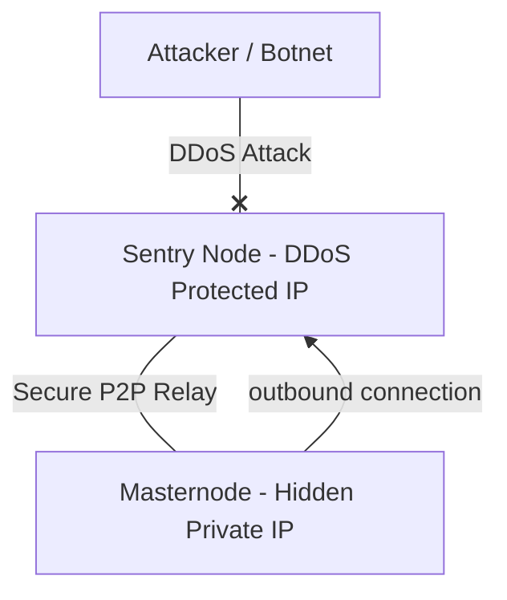

# Sentry Node (Proxy Relay) Setup Guide

Sentry Node architecture is an advanced infrastructure pattern designed to protect your real Masternode (and its quorum signing private keys) from targeted DoS/DDoS attacks.

In this layout, your active Masternode is completely shielded from the public internet (runs behind a private subnetwork or rejects all direct inbound connections) and communicates with the P2P network exclusively via DDoS-protected relay servers (Sentry Nodes).

---

## How It Works



* **Sentry Node (Edge Server):** A public VPS hosted on a DDoS-protected provider (OVH, Path.net, Cloudflare Magic Transit, etc.). The public network only interacts with this node's IP.
* **Masternode (Core Server):** The server running your masternode key. It does not accept any inbound public connections (`listen=0`) and only makes outbound connections to your own Sentry node.

---

## Setup Steps

### 1. Configure the Sentry Node (Edge Server)
Set up a standard `kristatechd` daemon on your public DDoS-protected Sentry server. This node does not need collateral, wallet funds, or masternode private keys.

Edit your `kristatech.conf` file using explicit relay-only isolation flags (high inbound capacity with wallet, staking, and masternode signing disabled):
```ini
# Sentry Node Config (Stateless Public Relay)
server=1
daemon=1
listen=1
port=27999
maxconnections=256
masternode=0
staking=0
disablewallet=1
```

Save your Sentry server's public IP address (e.g., `198.51.100.50`).

---

### 2. Configure the Real Masternode (Hidden)
On your hidden masternode server, edit your `kristatech.conf` file so it initiates outbound P2P links **exclusively** to your own Sentry node(s) and **never advertises its real IP address**:

```ini
# Masternode Configuration (Hidden Validator)
server=1
daemon=1
txindex=1
listen=0 # Deny all incoming public P2P connections

# Connect ONLY to your own Sentry node(s)
connect=198.51.100.50:27999

# IMPORTANT: Do NOT set externalip= to your hidden server's real IP!
# If your Cold Wallet masternode.conf announces a public endpoint, point masternode.conf
# to your DDoS-protected Sentry IP (198.51.100.50:27999).

# Masternode Mode
masternode=1
```

> [!NOTE]
> Masternode keys are managed via `activemasternode.conf` to support single-IP multi-masternode setups (`masternodeprivkey` is never placed in `kristatech.conf`). Because KRISTA consensus elections (`SEC-12`) track active Masternodes 100% on-chain via unspent `4,200 KRISTA` collateral and `2,880`-block on-chain activity (`RegisterBlockMasternodeActivity` / `SendOnChainPing`), your hidden Masternode participates in ADAM committees, PoS co-signing, and LLMQ quorums seamlessly over its outbound Sentry connection without exposing its real IP.

Start your daemon:
```bash
kristatechd
```

---

## Firewall (UFW) Recommendations

On your core masternode server, block all inbound public P2P traffic and allow SSH strictly from your trusted management IP (outbound connections to your Sentry node remain permitted by `default allow outgoing`):

```bash
# Apply default UFW rules (blocks all unsolicited inbound traffic, including port 27999)
sudo ufw default deny incoming
sudo ufw default allow outgoing

# Allow SSH only from your management IP (replace 1.2.3.4 with your admin IP)
sudo ufw allow from 1.2.3.4 to any port 22 proto tcp comment 'Safe SSH'

# Enable the firewall
sudo ufw enable
```

### Why this setup is secure:
1. Your hidden Masternode server's real IP address is never announced in P2P `addr` messages or `masternode.conf`, and unsolicited inbound packets are dropped at both UFW and `listen=0`.
2. Your masternode syncs blocks, broadcasts puzzle solutions (`ADAMSOL`), and co-signs LLMQ quorums (`PROPOSEBLOCK` / `QUORUMSIGSHARE`) exclusively through your DDoS-protected Sentry relay(s).
3. If a Sentry server is saturated by a volumetric attack, your hidden validator and its signing keys remain completely untouched — you can add or switch `connect=` to another Sentry IP immediately without downtime.
