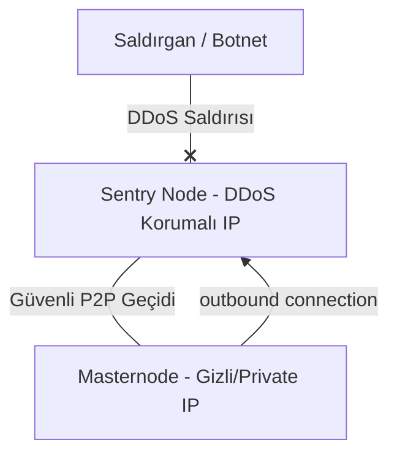

# Sentry Node (Sınır Düğümü) Kurulum Kılavuzu

Sentry Node mimarisi, gerçek Masternode'unuzu (ve quorum imzalama anahtarınızı) DDoS/DoS saldırılarından korumak için tasarlanmış gelişmiş bir altyapı çözümüdür. 

Bu mimaride, gerçek masternode'unuz dış dünyaya tamamen kapatılır (gizli IP'de çalışır veya tüm gelen bağlantıları reddeder) ve internete sadece DDoS korumalı public proxy düğümleri (Sentry Node) üzerinden bağlanır.

---

## Mimarinin İşleyişi



* **Sentry Node (Sınır Sunucusu):** DDoS korumalı (OVH, Path.net, Cloudflare Magic Transit vb.) herhangi bir public sunucu. Dış dünya sadece bu düğümün IP adresini görür.
* **Masternode (Ana Sunucu):** Masternode cüzdanınızın çalıştığı sunucu. Dışarıdan gelen hiçbir bağlantıyı kabul etmez (`listen=0`), sadece kendi Sentry düğümünüze dışa doğru (outbound) bağlanır.

---

## Kurulum Adımları

### 1. Sentry Node (Sınır Sunucusu) Yapılandırması
Sentry sunucusunda standart `kristatechd` daemon'ını kurun. Bu düğümün teminat, cüzdan bakiyesi veya masternode özel anahtarı barındırmasına gerek yoktur.

`kristatech.conf` dosyasını yalnızca aktarım (relay) izolasyonu sağlayan standart parametrelerle (yüksek bağlantı kapasitesi; cüzdan, staking ve masternode imzalama kapalı) düzenleyin:
```ini
# Sentry Node Yapılandırması (Durumsuz Açık Aktarım Düğümü)
server=1
daemon=1
listen=1
port=27999
maxconnections=256
masternode=0
staking=0
disablewallet=1
```

Sentry sunucusunun IP adresini kaydedin (Örn: `198.51.100.50`).

---

### 2. Gerçek Masternode Yapılandırması (Gizli)
Gizli masternode sunucunuzda `kristatech.conf` dosyasını dışa doğru P2P bağlantılarını **yalnızca** kendi Sentry düğüm(ler)inize açacak ve **kendi gerçek IP adresini asla ağa anons etmeyecek** şekilde düzenleyin:

```ini
# Masternode Yapılandırması (Gizli Doğrulayıcı)
server=1
daemon=1
txindex=1
listen=0 # Dışarıdan gelen tüm P2P bağlantı isteklerini reddet

# Sadece kendi Sentry düğüm(ler)inize bağlanın
connect=198.51.100.50:27999

# ÖNEMLİ: externalip= satırına gizli sunucunuzun gerçek IP adresini ASLA yazmayın!
# Soğuk cüzdandaki masternode.conf dosyasında bir IP tanımlıyorsanız, DDoS korumalı
# Sentry IP adresinizi (198.51.100.50:27999) kullanın.

# Masternode Modu
masternode=1
```

> [!NOTE]
> Masternode anahtarları, tek IP üzerinde çoklu masternode (multi-masternode) desteği için `activemasternode.conf` üzerinden yönetilir (`kristatech.conf` içine `masternodeprivkey` yazılmaz). KRISTA konsensüs seçimleri (`SEC-12`) aktif Masternode'ları %100 zincir üstü olarak (`4.200 KRISTA` harcanmamış teminat + `2.880` blokluk zincir üstü aktiflik / `SendOnChainPing`) takip ettiğinden, gizli Masternode'unuz gerçek IP adresini hiç ifşa etmeden dışa doğru Sentry bağlantısı üzerinden ADAM komitelerine, PoS ortak imzalamaya ve LLMQ kurullarına kesintisiz katılır.

Düğümü başlatın:
```bash
kristatechd
```

---

## Güvenlik Duvarı (Firewall) Önlemleri

Gerçek masternode sunucusunda dışarıdan gelen tüm P2P trafiğini UFW ile engelleyin ve yalnızca kendi yönetim IP'nizden SSH erişimine izin verin (Sentry düğümünüze giden dışa doğru bağlantılar `default allow outgoing` ile açık kalır):

```bash
# UFW varsayılan kurallarını uygulayın (27999 dahil tüm gelen istekleri kapatır)
sudo ufw default deny incoming
sudo ufw default allow outgoing

# SSH portunu sadece kendi yönetim IP'nize açın (1.2.3.4 yerine kendi IP'nizi yazın)
sudo ufw allow from 1.2.3.4 to any port 22 proto tcp comment 'Safe SSH'

# UFW'yi aktif edin
sudo ufw enable
```

### Bu mimari neden güvenlidir:
1. Gizli Masternode sunucunuzun gerçek IP adresi P2P `addr` mesajlarında veya `masternode.conf` içinde asla anons edilmez ve dışarıdan gelen tüm paketler hem UFW hem de `listen=0` katmanında düşürülür.
2. Masternode'unuz blok verilerini senkronize etmeyi, bulmaca çözümlerini (`ADAMSOL`) yayınlamayı ve LLMQ korum imzalarını (`PROPOSEBLOCK` / `QUORUMSIGSHARE`) oylamayı tamamen DDoS korumalı Sentry sunucunuz üzerinden sürdürür.
3. Sentry sunucunuz yoğun bir hacimsel DDoS saldırısı altında kalsa bile imzalama anahtarlarınızın bulunduğu gizli masternode sunucunuz hiçbir zarar görmez; yeni bir Sentry IP'si ekleyip `connect=` satırını güncelleyerek kesintisiz devam edebilirsiniz.
