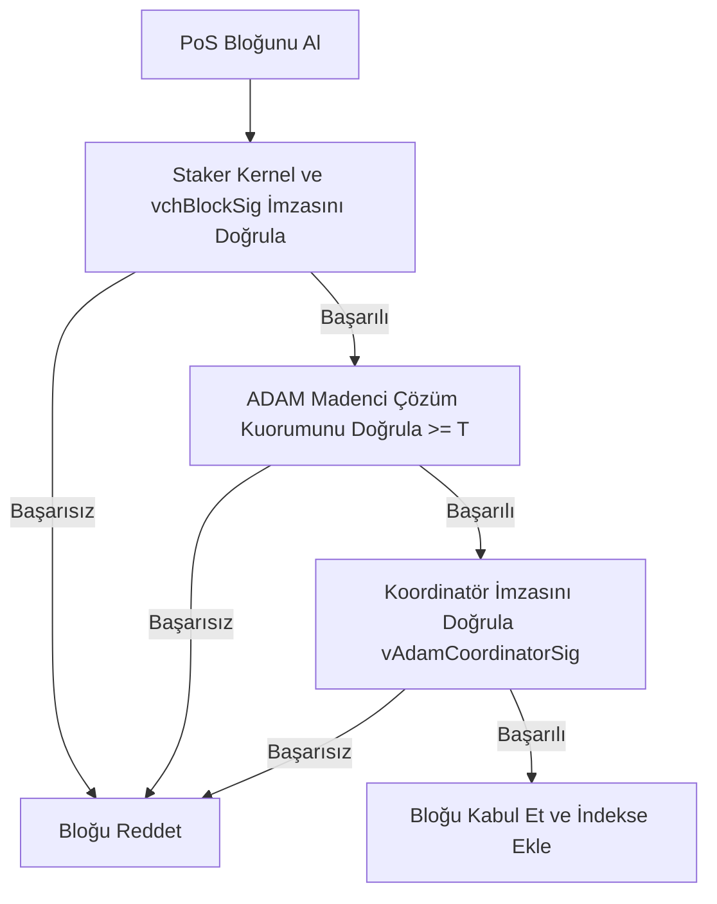

```
KTIP: 0004
Başlık: PoMBL Çift İmza Doğrulama Kuralları (PoMBL Dual-Signature Validation)
Yazar: KristaTech Core Developers
Durum: Active
Tür: Standard Track (Consensus)
Oluşturulma Tarihi: 2026-06-16
```

## Özet
Bu öneri, KRISTA ağında işbirlikçi Proof-of-Stake (PoS) blokları için uygulanan **PoMBL (Proof of Masternode and Block Lock)** çift imza doğrulama kuralını tanımlamaktadır. PoMBL, Proof-of-Stake (PoS) yükseltme yüksekliğinden itibaren üretilen her PoS bloğunun (`IsProofOfStake()`) iki farklı imza türü altında kilitlenmesini zorunlu kılar: stake edenin imzası (`vchBlockSig`) ve seçilen ADAM Koordinatörünün imzası (`vAdamCoordinatorSig`; ayrıca `UPGRADE_MODELD` aktifleştiğinde 5'te 3 LLMQ `vQuorumSig` — işbirlikçi ADAM PoW blokları ise `vchBlockSig` alanı boş olarak `vAdamCoordinatorSig` ve `vQuorumSig` taşır). Bu imzalardan herhangi biri eksik olan veya geçersiz imza içeren PoS blokları konsensüs doğrulama kuralları tarafından kesin bir şekilde reddedilir.

## Motivasyon
Standart Proof-of-Stake ağlarında, blok üretimi yalnızca kazanan staker cüzdanının gizli anahtarı tarafından belirlenir. Bu model aşağıdaki sorunlara yol açar:
1. **Bencil Staking (Selfish Staking)**: Staker cüzdanlarının gizli zincirler oluşturmak için blokları saklaması.
2. **Onaylayıcı Rüşveti ve Hedefli DoS**: Sıradaki onaylayıcılar önceden bilinebildiği veya tahmin edilebildiği için, ağ saldırılarının veya rüşvet girişimlerinin hedefi haline gelirler.
3. **Nothing-at-Stake**: Rakip birden fazla çatallanma (fork) üzerinde blok başlığı imzalamanın maliyetsiz olması.

PoMBL, staker'ları bir blok yayılmadan önce dinamik olarak seçilen ADAM Koordinatöründen doğrulama kilidi almaya zorlayarak bu sorunları çözer.

## Teknik Özellikler

### 1. Çift İmza Yapısı
`Consensus::UPGRADE_POS` etkinleştiğinde (Mainnet/Testnet üzerinde `nHeight >= 200`, Regtest üzerinde `nHeight >= 251`) üretilen her işbirlikçi PoS bloğu (`src/primitives/block.h` içindeki `CBlock` / `CBlockHeader`) iki bağımsız kriptografik imza alanı içermelidir (işbirlikçi ADAM PoW bloklarında ise `vchBlockSig` boş bırakılarak `vAdamCoordinatorSig` doldurulur):

* `vchBlockSig`: Kazanan coin-stake girdi UTXO'sunun gizli anahtarı kullanılarak staker tarafından oluşturulan Proof-of-Stake blok imzası. Nihai blok başlığı hash değerini imzalar.
* `vAdamCoordinatorSig`: Belirlenimci hibrit BLS12-381 + ECDSA fallback imza şeması kullanılarak seçilen ADAM Koordinatörü tarafından oluşturulan koordinatör imzası. *Koordinatör imzasının kendisi ve varsa Versiyon 12'deki LLMQ imzası (`vQuorumSig`) hariç tutularak* hesaplanan blok başlığı hash değerini imzalar.

---

### 2. Doğrulama Kuralları
İşbirlikçi bir PoS bloğu doğrulayıcı düğümler tarafından işlendiğinde (`src/main.cpp` içindeki `CheckBlock()`), aşağıdaki doğrulama sırası zorunlu kılınır:

#### A. Proof-of-Stake Doğrulaması
1. `coinstake` işleminin yapısını doğrulayın.
2. Staking kernel hash değerinin hedef zorluğu karşıladığını doğrulayın:

   $$\text{kernelHash} < \left\lfloor \frac{W_{\text{total}}}{100} \right\rfloor \times \text{Target}$$

3. Stake edenin blok imzasını (`vchBlockSig`), kazanan coinstake UTXO'sunun açık anahtarına karşı doğrulayın.

---

#### B. ADAM Quorum Doğrulaması
1. `SelectAdamNodes()` aracılığıyla o blok yüksekliği için seçilen madenciler listesini sorgulayın ve `nTimeElapsed >= 60 sn` sonrasında gerçekleşen yedek doğrulayıcı devirlerini bloğun `CCoinsViewCache* pView` görünümüne karşı `ValidateAdamCommitteeForTime()` ile doğrulayın.
2. `vAdamSolutions` boyutunun seçilen madenci sayısıyla eşleştiğini doğrulayın.
3. `vAdamSolutions` dizisi üzerinde döngü gerçekleştirerek geçerli, boş olmayan, imzalı kısmi PoW çözümlerini sayın.
4. Geçerli çözümlerin sayısının gerekli konsensüs eşiğini ($T_{\text{eff}} = \text{GetAdamEffectiveThreshold}(nHeight, nTimeElapsed, nActiveMasternodes)$) karşıladığını doğrulayın:
   - **Temel Eşik (`nTimeElapsed < 120 sn`)**: Mainnet / Regtest üzerinde bootstrap süresince (`nHeight < nAdamThresholdBootstrapLimit`) `5`, sonrasında `7` çözüm (Testnet üzerinde bootstrap sonrasında `3`).
   - **Zamana Bağlı Gevşetilmiş Eşik (`nTimeElapsed >= 120 sn`)**: Her `60 sn`'de bir `1` düşürülerek `ADAM_MIN_RELAXED_THRESHOLD = 5` değerine (`> 4` MN-dışı koltuk; bootstrap sonrasında veya aktif MN $\ge 7$ iken en az 1 Aktif Masternode katılımını zorunlu kılar; erken bootstrap aşamasında aktif MN $< 7$ iken `ADAM_MIN_RELAXED_THRESHOLD_BOOTSTRAP = 3`) kadar gevşetilir.
5. Boş olmayan her bir çözümdeki madenci imzalarını, ilgili komite koltuğunun açık anahtarına (`block.vAdamMiners[i]`) karşı doğrulayın.

---

#### C. Koordinatör İmzası Doğrulaması
1. `SelectAdamNodes()` aracılığıyla o blok yüksekliği için seçilen Koordinatörün açık anahtarını sorgulayın.
2. `vAdamCoordinatorSig` (ve Versiyon 12'de `vQuorumSig`) hariç tutularak blok başlığı hash değerini hesaplayın.
3. `vAdamCoordinatorSig` imzasının, `VerifyBLSWithECDSAFallback()` kullanılarak hesaplanan blok başlığı hash değerini imzalayan beklenen Koordinatörün açık anahtarıyla eşleşen geçerli bir imza olduğunu doğrulayın.

---

### 3. Konsensüs Dayatması
Bir PoS bloğunda doğrulama adımlarından herhangi biri (PoS, ADAM Quorumu veya Koordinatör İmzası) başarısız olursa, blok konsensüs ihlali hatası (`bad-cb-length`, `bad-pos-sig`, `bad-adam-quorum` veya `bad-adam-coord-sig`) ile reddedilir. `vAdamCoordinatorSig` içermeyen tek imzalı PoS blokları kesinlikle geçersizdir.



## Geriye Dönük Uyumluluk
* İşbirlikçi PoS çift imza doğrulama kuralları `Consensus::UPGRADE_POS` yüksekliğinde (Mainnet/Testnet üzerinde `200`, Regtest üzerinde `251`) etkinleşir (`Consensus::UPGRADE_ADAM` tüm ağlarda `200` yüksekliğinde, Sürüm 12 başlık serileştirmesi ise `Consensus::UPGRADE_POMBL` yüksekliğinde — Mainnet `2000`, Testnet `400`, Regtest `300` — devreye girer).
* `UPGRADE_ADAM` (`< 200`) öncesindeki bloklar saf PoW bootstrap bloklarıdır ve PoS kernel doğrulamasını ya da koordinatör imzalarını zorunlu kılmaz.

## Referans Uygulama
* Blok ilkel (primitive) sınıf genişletmeleri: `src/primitives/block.h` ve `src/primitives/block.cpp`.
* Staker blok imzalama ve uzaktan koordinatör ortak imzalama (`POSCOORDREQ` / `POSCOORDSIG`): `src/blocksignature.cpp` içindeki `SignBlock()` ve `src/miner.cpp` içindeki `ThreadStakeMinter()`.
* Doğrulama kuralları: `src/main.cpp` içindeki `CheckBlock()` ve `ContextualCheckBlockHeader()`.
